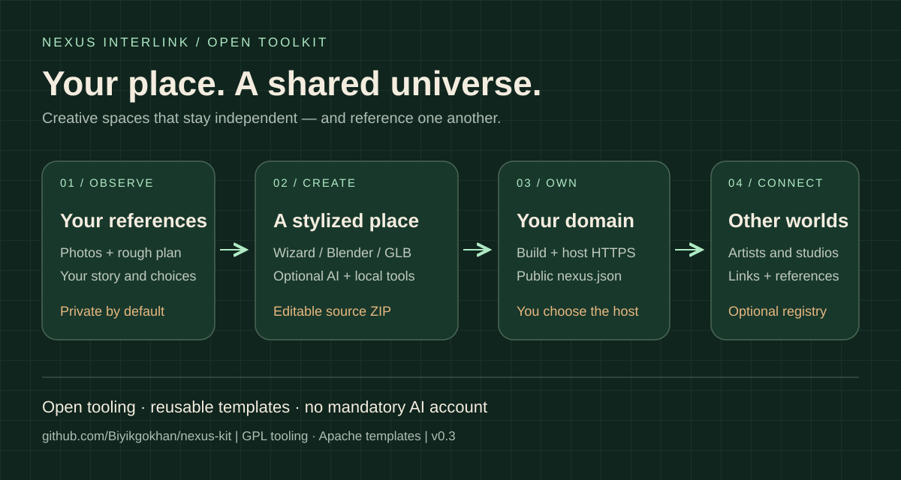

# Nexus Kit · places that reference each other

**An open toolkit for creative studios, artists and small spaces to build stylized 3D places on their own domains.** Connect them through HTTPS links and a small, engine-independent manifest. AI is optional.

[English guide](docs/en/README.md) · [Integrations](docs/INTEGRATIONS.md) · [Roadmap](ROADMAP.md) · [Governance](GOVERNANCE.md)



## Start here

**Try the live wizard:** [English](https://gokhanbiyik.com/nexus-kit/?lang=en) · [Türkçe](https://gokhanbiyik.com/nexus-kit/). Choose identity, room, objects and links. Download **Ready-to-publish site ZIP**, extract it and upload its contents to your own HTTPS website's root. **No Node/npm is required for this export.** Include hidden .well-known/ and follow the bilingual START-HERE.txt in the ZIP. Hosting/domain costs remain yours; registry inclusion requires manual review.

**Türkçe:** Sihirbazda mekânını düzenle, **Yayına hazır site ZIP’i** indir, içindeki dosyaları kendi HTTPS sitenin köküne yükle. Node/npm gerekmez. Gizli .well-known/ dizinini de yükle; ZIP içindeki START-HERE.txt Türkçe/İngilizce rehberdir. Domain/hosting gideri sana aittir. Fotoğraflar yalnız tarayıcı içi referanstır; yüklenmez, AI’a gönderilmez, ZIP’e girmez. Atlas kaydı ayrı başvuru ve bakımcı incelemesi gerektirir.

### Optional developer workflow / İsteğe bağlı kaynak kod yolu

Running the wizard locally or building the separate **Source code ZIP** requires **Node.js 22.12+** and npm. Blender is optional. No npm registry package or approved app-store listing is claimed.

```sh
git clone https://github.com/Biyikgokhan/nexus-kit.git
cd nexus-kit
npm ci
npm run wizard
```

For code-level customization, extract the **Source code ZIP**, then run:

```sh
npm install
npm run dev
npm run build
```

Host the source project's dist/ directory, including hidden files. Builds validate place.json and regenerate public manifests. Keep /.well-known/nexus.json at your domain root.

To edit a ready-to-publish export, reimport its place.json backup into the wizard and download a fresh ZIP. Editing that backup alone does not change the embedded site. Preview through an HTTP(S) server, not by double-clicking index.html.

**Türkçe:** Kodla düzenleme için ayrı kaynak ZIP’ini indir, yukarıdaki komutlarla derle ve dist/ klasörünü yayınla. Hazır paketi değiştirmek için yedek place.json dosyasını sihirbaza geri aktar ve yeni paket indir. Siteyi HTTP(S) sunucusunda aç; index.html dosyasına çift tıklamak desteklenen önizleme değildir.

## What works in 0.3.0

- TR/EN wizard: live orbitable Three.js preview, five object types, local reference previews, ready-to-publish site ZIP, separate source ZIP and optional AI brief.
- Apache-licensed standalone starter: responsive text navigation, procedural room, rendered triangle/draw-call counters, GLB loading and manifests.
- CLI scaffolding, offline sketch grids, checks, Blender export script and provider-neutral harness.
- Claude Code and Codex skills, portable plugin manifests, three read-only local MCP tools.
- Public bilingual [connection requests](https://github.com/Biyikgokhan/nexus-kit/issues/new?template=place-connection.yml), with human review and a private maintenance registry.

This starter is a small editable diorama. Photos are references; it does not reconstruct buildings. First-person movement, clickable 3D portals, photogrammetry, hosted AI, automatic atlas enrollment and the complete Fudō engine are not included. Ordinary page links remain accessible without WebGL.

## Bring your creative tools

Own photographs + a rough plan + your description form the brief. Model in Blender or any GLB exporter, put `place.glb` in `models/` in the ready site (or `public/models/` in the source project), then use the starter’s load-model button. You can replace the renderer: Nexus Interlink is JSON and HTTPS, not a mandatory engine.

```sh
node bin/nexus-kit.mjs init ../my-studio --yes --name="My Studio" --url=https://studio.example
cd ../my-studio
npm install
npm run dev
node ../nexus-kit/bin/nexus-kit.mjs harness --provider=codex
# alternatively: --provider=claude-code
```

[Integrations](docs/INTEGRATIONS.md) covers Blender, Claude, Codex and ChatGPT. You choose whether to share references with an AI provider. The wizard makes no provider calls.

## Host yourself, request a connection / Kendin barındır, bağlantı iste

[Self-hosting and the open protocol / Kendi sunucunda kurulum ve açık protokol](docs/SELF-HOST.md). Each place uses its own HTTPS host. No paid AI or Nexus-hosted server is required. Hosting costs stay with each participant. / Her mekân kendi HTTPS sunucusunu kullanır; ücretli AI veya Nexus sunucusu gerekmez. Domain/hosting gideri katılımcıya aittir.

## Why this exists

Participants can introduce Nexus and recommend other places through ordinary links on their own sites. Each owner chooses their neighbours; reciprocal links are optional. The [TR/EN HTML example](docs/SELF-HOST.md#discovery-through-your-own-site--kendi-siten-üzerinden-keşif) adds visible links beside any 3D view without a tracking script. / Katılımcılar kendi sitelerinde Nexus'u tanıtıp seçtikleri komşu mekânlara bağlantı verebilir. Karşı bağlantı isteğe bağlıdır; rehberde takip betiği gerektirmeyen Türkçe/İngilizce HTML örneği var.

[gokhanbiyik.com](https://gokhanbiyik.com) and [fudo.tattoo](https://fudo.tattoo) interpret recognizable creative spaces as stylized worlds. The aim is a network where studios, galleries and artists reference one another while owning their hosting and work.

Production artwork, private references and services are separate from the toolkit. See the [release review](docs/RELEASE-REVIEW.md). Numbered Turkish design documents preserve the broader goals; this README and the roadmap define shipped scope.

## Contribute and license

```sh
npm ci
npm test
npm run build:wizard
npm pack --dry-run
```

Read [CONTRIBUTING](CONTRIBUTING.md), [SECURITY](SECURITY.md) and [GOVERNANCE](GOVERNANCE.md). Help with accessibility, mobile measurements, translations, GLB workflows or protocol interoperability.

Tooling, wizard, editor, harness, skills and MCP: **GPL-3.0-or-later**. Standalone templates, schema and protocol: **Apache-2.0**. Original artwork stays yours; dependency licenses and notices still apply. Commercial use is permitted under these licenses. Names and demo media have separate terms: [scope](NOTICE.md), [third parties](THIRD-PARTY.md), [assets](ASSETS.md), [trademarks](TRADEMARKS.md).

This is a maintainer-led project working toward community stewardship, not an incorporated foundation or an affiliate of Blender, Anthropic or OpenAI.


Language coverage / Dil kapsamı: [English & Türkçe](docs/BILINGUAL.md).
