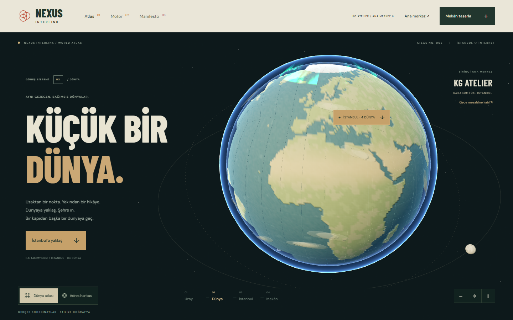
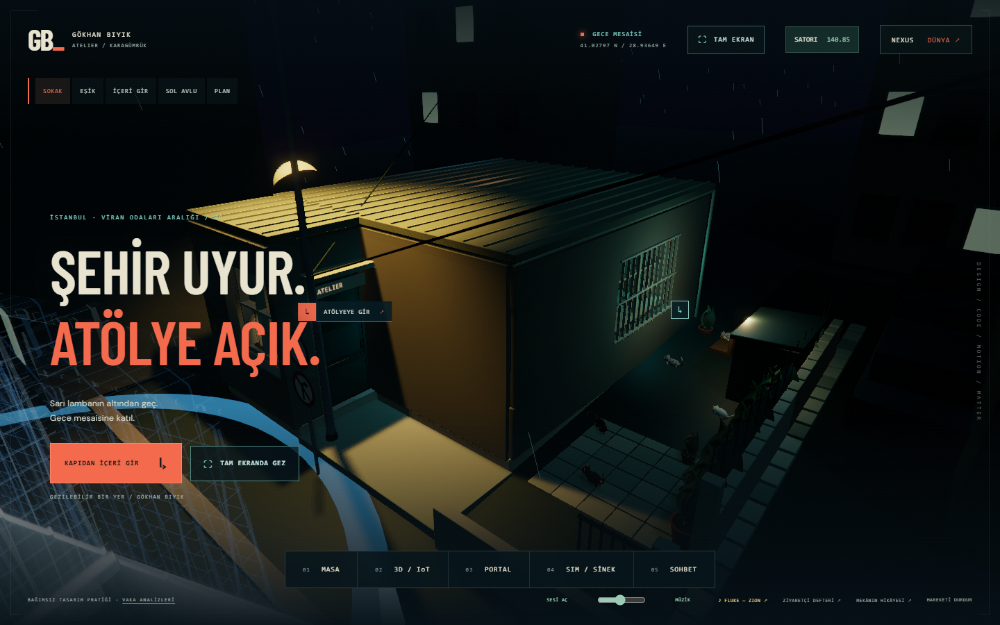
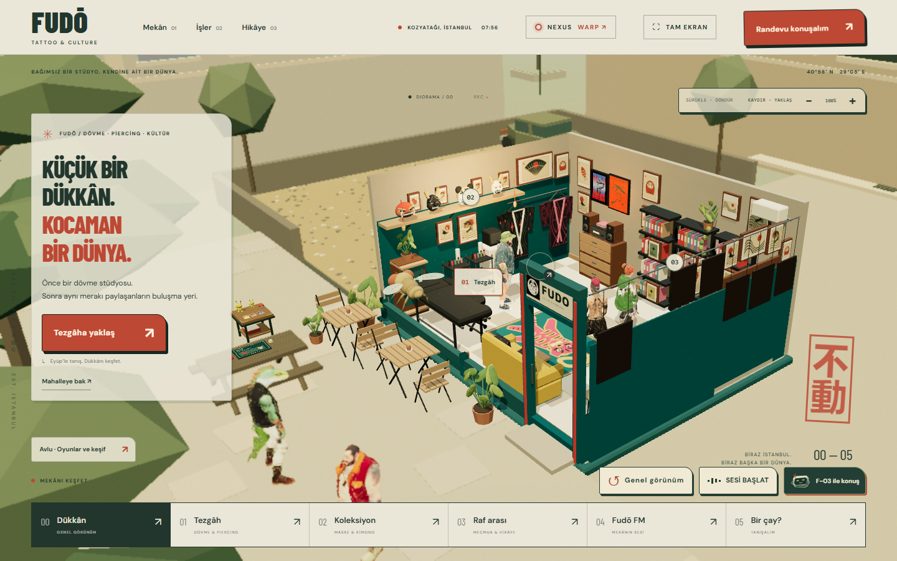
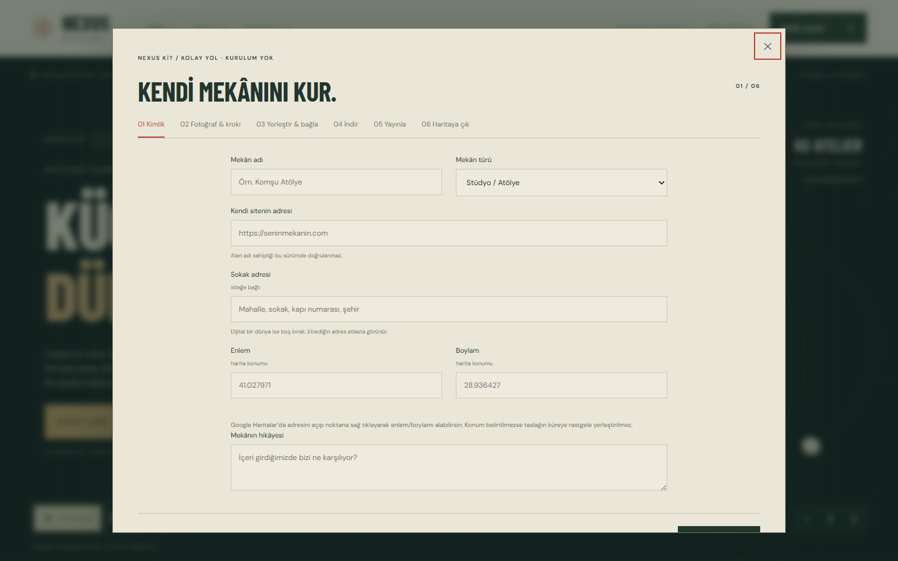
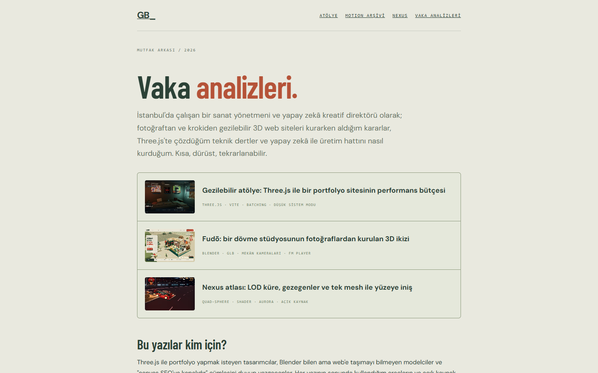

# Nexus Kit — kendi 3B mekânını kur, haritaya çık

**EN —** Nexus Kit is the open-source setup wizard and AI harness behind [fudo.tattoo](https://fudo.tattoo) and [gokhanbiyik.com](https://gokhanbiyik.com): turn a few phone photos and a hand-drawn sketch into a walkable, optimised Three.js place on your own domain, with your own keys, then appear as a point on the [Nexus atlas](https://gokhanbiyik.com/nexus/). Two paths: a browser wizard for non-technical owners and a CLI + Blender pipeline for modellers. Docs are in Turkish for now; an English translation is on the [roadmap](ROADMAP.md). Licensing follows the Blender model: the tooling is GPL-3.0, the templates/schema/protocol are Apache-2.0 (whatever you build with it is yours), the names are trademarks. Not on npm yet: `npx github:Biyikgokhan/nexus-kit doctor`.



> **Rehberin Satori.** Karagümrük atölyesinin uçan droidi sihirbazda seni karşılar; 30 saniyelik tanıtımı izle: [docs/video/nexus-kit-tanitim.mp4](docs/video/nexus-kit-tanitim.mp4) · [GIF önizleme](docs/video/nexus-kit-tanitim.gif)

> Birkaç telefon fotoğrafı ve kâğıda çizilmiş bir kroki ile, kendi alan adında yaşayan, gezilebilir bir Three.js mekânı. Sonra Nexus atlasında bir nokta.

Nexus Kit, [fudo.tattoo](https://fudo.tattoo) ve [biyikgokhan.com](https://gokhanbiyik.com) (KG Atelier) dünyalarının arkasındaki yöntemin açık kaynak kurulum sihirbazı ve yapay zekâ harness paketidir. İki site de 3D modelleme aracının önerdiği hazır kalıplarla değil, gerçek fotoğraf + kroki + sahibinin anlatımıyla ve optimize edilmiş bir Three.js stilizasyonuyla kuruldu. Bu paket o yöntemi herkesin kullanabileceği hâle getirir.

Belgeler Türkçe yazıldı; İngilizce çeviri yol haritasında.

## Ekolün örnekleri

| KG Atelier — Karagümrük gece atölyesi | Fudō — Kozyatağı dövme stüdyosu |
| --- | --- |
|  |  |
| [gokhanbiyik.com](https://gokhanbiyik.com) · birinci şahıs, sokaktan içeri | [fudo.tattoo](https://fudo.tattoo) · diorama, tezgâha yaklaş |

| Kolay yol sihirbazı (tarayıcı) | Mutfak arkası yazıları |
| --- | --- |
|  |  |
| [gokhanbiyik.com/nexus/#kur](https://gokhanbiyik.com/nexus/#kur) | [gokhanbiyik.com/case-studies](https://gokhanbiyik.com/case-studies/) |

## Kime, ne veriyor

| Sen kimsin | Hangi yol | Ne kurman gerekir | Sonuç |
| --- | --- | --- | --- |
| Bilişime uzak; dükkânı, atölyesi, bahçesi var; telefonla fotoğraf çekebilir, kâğıda kroki çizebilir | **Kolay yol** (tarayıcı sihirbazı) | Hiçbir şey. Modern bir tarayıcı yeter. | Statik bir ZIP: kendi alan adına yüklenir, Nexus haritasında görünür. |
| 3B modellemeyi biliyor ya da öğrenmek istiyor; Blender açabiliyor, terminalden korkmuyor | **Modelci yolu** (CLI sihirbazı + Blender hattı) | Node 22, Blender 4.5, Git | KG Atelier / Fudō sınıfında, yürünebilir, istasyonlu, portal açan tam bir dünya. |

İki yol aynı yerde birleşir: `nexus.json` manifesti → kendi HTTPS alan adının kökü → topluluk kaydı → atlasta bir nokta.

## Üç ilke

1. **Herkes kendi alan adında, kendi token'ıyla.** Nexus Kit hiçbir zaman senin adına barındırmaz, senin adına yapay zekâ çağırmaz, anahtarını görmez. Yapay zekâ isteğe bağlıdır; sihirbaz yapay zekâsız da biter.
2. **Fotoğraf ve kroki yorumlanır, ölçülmüş rölöve iddia edilmez.** Manifestte bu dürüstçe yazılır (`geometry: photo-sketch-and-owner-layout-interpretation`). Görmediğin oda modellenmez; Google görüntüsü, başkasının eseri, hazır oyun varlığı pakete girmez.
3. **Ekol tek: optimize Three.js stilizasyonu.** Bütçeler, malzeme kuralları, bevel kuralı, batch kuralı, gece paleti ve navigasyon sözleşmesi [docs/04-ART-DIRECTION.md](docs/04-ART-DIRECTION.md) içinde. Sihirbaz bu kurallardan sapan bir sahneyi paketlemez; harness bu kuralları ajanın sistem talimatı olarak taşır.

## Hızlı başlangıç (tasarım hedefi)

Kolay yol:

```text
1. https://gokhanbiyik.com/nexus/#kur  (statik sihirbaz; hiçbir şey yüklenmez)
2. 3 fotoğraf + 1 kroki fotoğrafı seç
3. Krokinin üstüne masa / koltuk / bitki / çerçeve / kapı sürükle
4. Canlı 3B önizleme → "Paketi indir"
5. ZIP'i kendi alan adına yükle (Vercel / Netlify / GitHub Pages / cPanel — adım adım)
6. "Haritaya çık" → topluluk kaydına tek tıkla başvuru
```

Modelci yolu:

```bash
git clone https://github.com/Biyikgokhan/nexus-kit && cd nexus-kit && npm test   # ya da: npx github:Biyikgokhan/nexus-kit <komut>
node bin/nexus-kit.mjs init my-place   # gereksinim kontrolü + proje iskeleti
node bin/nexus-kit.mjs sketch              # kroki + fotoğrafları oda planına çevir (AI isteğe bağlı)
node bin/nexus-kit.mjs blender             # Blender 4.5 background hattıyla GLB üret
node bin/nexus-kit.mjs check               # bütçe, şema, .well-known, ekol kuralları
node bin/nexus-kit.mjs publish             # kendi alan adına yayın ve kayıt başvurusu
```

Durum (0.1): `doctor`, `init`, `manifest`, `check`, `blender`, `harness`, `publish` çalışıyor (`bin/nexus-kit.mjs`, testler `tests/`). `sketch` (kroki → plan) ve `check --browser` yol haritasında. npm'de henüz yayımlanmadı; bu depoyu klonlayıp `node bin/nexus-kit.mjs <komut>` ya da `npm link` ile kullan. Kolay yol sihirbazı atlas sitesinde: https://gokhanbiyik.com/nexus/#kur (yayın bekliyor). Komut sözleşmesi: [docs/03-SIHIRBAZ-MODELCI-YOLU.md](docs/03-SIHIRBAZ-MODELCI-YOLU.md).

## Belgeler

| Dosya | İçerik |
| --- | --- |
| [docs/00-TASARIM-OZETI.md](docs/00-TASARIM-OZETI.md) | Bir sayfada bütün tasarım: akış, kararlar, neyin var neyin yok olduğu |
| [docs/01-GEREKSINIMLER.md](docs/01-GEREKSINIMLER.md) | Minimum bilgisayar, kurulacaklar listesi, yol yol |
| [docs/02-SIHIRBAZ-KOLAY-YOL.md](docs/02-SIHIRBAZ-KOLAY-YOL.md) | Bilişime uzak kullanıcı için ekran ekran sihirbaz metni |
| [docs/03-SIHIRBAZ-MODELCI-YOLU.md](docs/03-SIHIRBAZ-MODELCI-YOLU.md) | CLI sihirbazı, Blender hattı, motor şablonu |
| [docs/04-ART-DIRECTION.md](docs/04-ART-DIRECTION.md) | Ekol: stilizasyon sözleşmesi, bütçeler, yasaklar |
| [docs/05-HARNESS.md](docs/05-HARNESS.md) | Yapay zekâ harness'ı: kendi token'ın, yerel model, Claude, Astra; sınırlar |
| [docs/06-PROTOKOL-VE-HARITA.md](docs/06-PROTOKOL-VE-HARITA.md) | `nexus-interlink/0.2`, barındırma, kayıt, haritada görünme |
| [docs/07-TOPLULUK.md](docs/07-TOPLULUK.md) | Repo yapısı, katkı, kayıt defteri, lisans ayrımı |
| [ROADMAP.md](ROADMAP.md) | Sıra: neyi önce yapıyoruz |

## Paket içeriği

```text
nexus-kit/
  README.md               bu dosya
  ROADMAP.md
  docs/                   tasarım ve kullanıcı belgeleri
  harness/                ajan-bağımsız yapay zekâ paketi
    AGENTS.md             her ajanın okuyacağı tek talimat dosyası (Claude Code için CLAUDE.md olarak kopyalanır)
    skills/               nexus-place · nexus-art-direction · nexus-blender · nexus-publish
    providers/            claude-code · claude-api · ollama · astra · .env.example
  schema/                 nexus-interlink-0.2.schema.json
  templates/              place.example.json · kroki şablonu · README şablonu
```

## Lisans

Blender modeli: **araç açık, mekân senin, ad bizim.**

- Kurulum sihirbazı, denetçi ve harness (`bin/`, `lib/`, `harness/`, belgeler): **GPL-3.0-or-later**. Geliştirip dağıtırsan kaynağı da paylaşırsın; kapalı bir "Nexus Kit Pro" olmaz.
- Şablonlar, `nexus-interlink` şeması ve protokol (`templates/`, `schema/`, protokol belgesi): **Apache-2.0**. Kitle kurduğun site, manifest ve modeller **senindir**; hiçbir açık kaynak yükümlülüğü taşımaz. Protokolü kendi motorunla da uygulayabilirsin.
- "Nexus Interlink", "Nexus Kit", "Satori" adları ve logo lisans kapsamı dışındadır ([TRADEMARKS.md](TRADEMARKS.md)). Çatal serbest, ad değişir.
- Fotoğrafların, eserlerin, logon ve alan adın senindir; paket bunlara hak vermez ([ASSETS.md](ASSETS.md)). Three.js MIT, fontlar SIL OFL, Natural Earth kamu malı ([THIRD-PARTY.md](THIRD-PARTY.md)).

Kapsam tablosu: [NOTICE.md](NOTICE.md). Telif: © 2026 Gökhan Bıyık.
